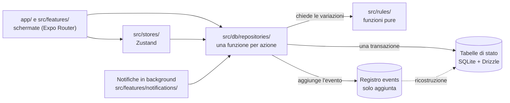
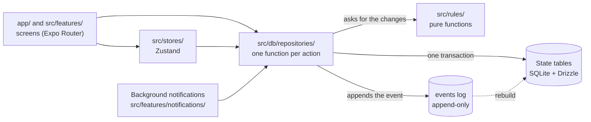

# Good Habits Quest Mobile

[Italiano](#italiano) · [English](#english)

---

## Italiano

**Good Habits Quest Mobile (GHQ Mobile)** è un habit tracker per iOS e Android che trasforma abitudini e obiettivi in un gioco di ruolo leggero. Funziona offline, senza account e senza server: tutti i dati restano sul telefono.

### Cosa fa

- **Missioni**: abitudini ricorrenti (giornaliere, a giorni fissi, «N volte a settimana», misurabili) e attività singole. Completarle dà esperienza (XP), monete, vita e punti alle statistiche dell'eroe.
- **Eroe**: livelli fino al 50 con titoli, sei statistiche, serie di giorni consecutivi, vita che cala quando si saltano le missioni previste.
- **Boss**: i grandi obiettivi si dividono in passi; ogni missione collegata fa danno al boss.
- **Compagno** e **negozio** con le monete guadagnate.
- **Sei temi** (Arcade, Fantasy, Cyberpunk, Lovecraft, Minimal chiaro e scuro) sopra un'unica struttura: cambiano palette, caratteri, compagno e lessico, non le funzioni.
- **Cinque lingue** (italiano, inglese, tedesco, francese, spagnolo).
- Niente multiplayer, niente intelligenza artificiale, niente annunci.

I requisiti completi sono in [`docs/riferimenti/analisi-funzionale.md`](docs/riferimenti/analisi-funzionale.md).

### Architettura

Le regole di gioco sono funzioni pure, testabili senza telefono. Le schermate non scrivono mai nel database: chiamano un'azione di un repository, che chiede le variazioni alle regole, apre **una** transazione, aggiorna le tabelle di stato e aggiunge un evento al registro `events`. Il registro è in sola aggiunta, quindi lo stato si può ricostruire da zero e ogni azione si può annullare.



Scelte che contano:

- `src/rules/` non importa React, Expo né il database; orologio e fuso orario arrivano come parametri, mai da `Date.now()`. Tutti i valori numerici stanno in `src/rules/config.ts`.
- I repository ricevono il database come parametro, con un tipo compatibile con `expo-sqlite` (nell'app) e `better-sqlite3` (nei test): gli stessi repository girano in entrambi i casi.
- Le azioni sono idempotenti (`idemKey`): un doppio tocco o una notifica ripetuta non completa due volte la stessa missione.
- Ogni migrazione dello schema fa prima una copia di sicurezza del database.

Struttura delle cartelle:

| Cartella                  | Contenuto                               |
| ------------------------- | --------------------------------------- |
| `app/`                    | Rotte di Expo Router, schermate sottili |
| `src/rules/`              | Regole di gioco pure                    |
| `src/db/`                 | Schema, client, repository              |
| `src/features/`           | Componenti e hook di una sezione        |
| `src/theme/`, `src/i18n/` | Temi e lingue                           |
| `src/content/`            | Modelli di missione, negozio, titoli    |
| `src/stores/`             | Store Zustand                           |
| `drizzle/`                | Migrazioni SQL generate                 |
| `test/`                   | Database in memoria e helper dei test   |

### Stack

React Native con Expo (TypeScript strict), Expo Router, Zustand, SQLite con expo-sqlite e Drizzle ORM, Zod, expo-notifications con expo-task-manager, i18next, react-native-reanimated. Test con Jest e React Native Testing Library; nei test il database gira su better-sqlite3. Dettagli e motivazioni in [`docs/riferimenti/stack-tecnologico.md`](docs/riferimenti/stack-tecnologico.md).

### Come avviarla

Servono Node LTS e un telefono Android (o un emulatore). L'app usa una _development build_, non Expo Go.

```bash
npm install
npm start          # server di sviluppo Expo
npm run android    # apre l'app su Android
```

La build di sviluppo si compila nel cloud con EAS (profilo `development` in [`eas.json`](eas.json)); non serve un Mac. Per provare le azioni delle notifiche sul telefono segui [`docs/prova-notifiche.md`](docs/prova-notifiche.md).

### Test e controlli

```bash
npm test             # Jest, con copertura (soglia 90% sulle righe di src/rules/)
npm run typecheck    # TypeScript senza emettere file
npm run lint         # ESLint e controllo di Prettier
npm run check        # i tre comandi sopra in sequenza
npx jest <file>      # un solo file di test
```

La CI di GitHub Actions ([`.github/workflows/ci.yml`](.github/workflows/ci.yml)) lancia `npm run check` a ogni push e pull request.

### Flussi completi con Maestro

La cartella [`.maestro/`](.maestro/) contiene i flussi end-to-end: primo avvio, completa e annulla da Oggi, crea una missione col solo nome, crea un boss e sconfiggilo, compra e usa una pozione, cambia tema e lingua, elimina tutti i dati. Ogni flusso parte da un'app senza dati e fa il primo avvio in inglese. Non girano in CI: Jest controlla solo che i file YAML si leggano e che ogni `testID` citato esista nel codice.

Servono [Maestro](https://docs.maestro.dev/getting-started/installing-maestro) (Java 17 o più recente), un emulatore Android acceso (o un telefono collegato con `adb`) con installata la _development build_, e il server di sviluppo avviato:

```bash
npm start            # in un terminale: Metro
npm run e2e          # in un altro: tutti i flussi (maestro test .maestro/)
maestro test .maestro/05-potion.yaml   # un solo flusso
```

I flussi aprono la build di sviluppo collegata a Metro su `http://10.0.2.2:8081`, l'indirizzo del computer visto dall'emulatore. Con un telefono vero passa l'indirizzo del computer, codificato per URL: `maestro test -e METRO_URL=http%3A%2F%2F192.168.1.10%3A8081 .maestro/`. Il flusso della pozione sposta l'orologio dell'app avanti di un giorno con il collegamento `ghq://dev/clock?days=1`, che esiste solo nelle build di sviluppo.

### Stato del progetto

In sviluppo, in fase iniziale. Il lavoro è diviso in task piccoli in [`docs/backlog-task.md`](docs/backlog-task.md), con un diario di ogni passo.

- **Fatto**: regole di gioco con i test, database e registro degli eventi, repository (completamento, annullamento, chiusura dei giorni, boss, negozio, ricostruzione dal registro), temi, lingue, caratteri, store, navigazione e codice del prototipo delle notifiche.
- **Da fare**: le schermate vere (oggi sono segnaposto), la prova delle notifiche sul telefono, i widget e le build per gli store. Non ci sono ancora schermate da mostrare.
- **Contenuti in bozza**: modelli di missione, titoli dell'eroe e testi in tedesco, francese e spagnolo sono da rivedere.
- **Licenza**: non ancora scelta.

---

## English

**Good Habits Quest Mobile (GHQ Mobile)** is a habit tracker for iOS and Android that turns habits and goals into a lightweight role-playing game. It works offline, with no account and no server: all data stays on the phone.

### Features

- **Quests**: recurring habits (daily, fixed weekdays, "N times a week", measurable) and one-off tasks. Completing them earns experience (XP), coins, health and hero stat points.
- **Hero**: levels up to 50 with titles, six stats, day streaks, and health that drops when scheduled quests are missed.
- **Bosses**: big goals are split into steps; every linked quest damages the boss.
- **Companion** and **shop** for the coins you earn.
- **Six themes** (Arcade, Fantasy, Cyberpunk, Lovecraft, Minimal light and dark) on a single structure: they change palette, fonts, companion and vocabulary, not features.
- **Five languages** (Italian, English, German, French, Spanish).
- No multiplayer, no AI, no ads.

The full requirements are in [`docs/riferimenti/analisi-funzionale.md`](docs/riferimenti/analisi-funzionale.md) (in Italian).

### Architecture

Game rules are pure functions, testable without a phone. Screens never write to the database: they call a repository action, which asks the rules for the changes, opens **one** transaction, updates the state tables and appends an event to the `events` log. The log is append-only, so the state can be rebuilt from scratch and every action can be undone.



Key decisions:

- `src/rules/` imports no React, no Expo and no database; the clock and time zone are passed in as parameters, never read from `Date.now()`. Every numeric value lives in `src/rules/config.ts`.
- Repositories take the database as a parameter, typed to work with both `expo-sqlite` (in the app) and `better-sqlite3` (in tests), so the same repositories run in both.
- Actions are idempotent (`idemKey`): a double tap or a repeated notification never completes the same quest twice.
- Every schema migration backs up the database first.

The folder layout is the table in the Italian section above.

### Stack

React Native with Expo (strict TypeScript), Expo Router, Zustand, SQLite with expo-sqlite and Drizzle ORM, Zod, expo-notifications with expo-task-manager, i18next, react-native-reanimated. Tests use Jest and React Native Testing Library; in tests the database runs on better-sqlite3. Details and rationale (in Italian) in [`docs/riferimenti/stack-tecnologico.md`](docs/riferimenti/stack-tecnologico.md).

### Getting started

You need Node LTS and an Android phone (or emulator). The app uses a _development build_, not Expo Go.

```bash
npm install
npm start          # Expo dev server
npm run android    # open the app on Android
```

The development build is compiled in the cloud with EAS (`development` profile in [`eas.json`](eas.json)); no Mac needed. To try the notification actions on a phone, follow [`docs/prova-notifiche.md`](docs/prova-notifiche.md) (in Italian).

### Tests and checks

```bash
npm test             # Jest with coverage (90% line threshold on src/rules/)
npm run typecheck    # TypeScript, no emit
npm run lint         # ESLint and Prettier check
npm run check        # the three commands above, in sequence
npx jest <file>      # a single test file
```

The GitHub Actions CI ([`.github/workflows/ci.yml`](.github/workflows/ci.yml)) runs `npm run check` on every push and pull request.

### End-to-end flows with Maestro

The [`.maestro/`](.maestro/) folder holds the end-to-end flows: first launch, complete and undo from Today, create a quest with its name only, create a boss and defeat it, buy and use a potion, change theme and language, delete all data. Every flow starts from an app with no data and goes through the first launch in English. They do not run in CI: Jest only checks that the YAML files parse and that every `testID` they cite exists in the code.

You need [Maestro](https://docs.maestro.dev/getting-started/installing-maestro) (Java 17 or newer), a running Android emulator (or a phone connected with `adb`) with the _development build_ installed, and the dev server running:

```bash
npm start            # in one terminal: Metro
npm run e2e          # in another: every flow (maestro test .maestro/)
maestro test .maestro/05-potion.yaml   # a single flow
```

The flows open the development build connected to Metro at `http://10.0.2.2:8081`, the computer's address as seen from the emulator. On a real phone, pass the computer's address, URL-encoded: `maestro test -e METRO_URL=http%3A%2F%2F192.168.1.10%3A8081 .maestro/`. The potion flow moves the app clock one day forward with the `ghq://dev/clock?days=1` link, which exists only in development builds.

### Project status

Under development, early stage. Work is split into small tasks in [`docs/backlog-task.md`](docs/backlog-task.md) (in Italian), with a log of every step.

- **Done**: game rules with tests, database and event log, repositories (completion, undo, day closing, bosses, shop, rebuild from the log), themes, languages, fonts, stores, navigation, and the notification prototype code.
- **To do**: the real screens (placeholders today), the on-device notification test, widgets and store builds. There are no screenshots to show yet.
- **Draft content**: quest templates, hero titles and the German, French and Spanish texts still need review.
- **License**: not chosen yet.
